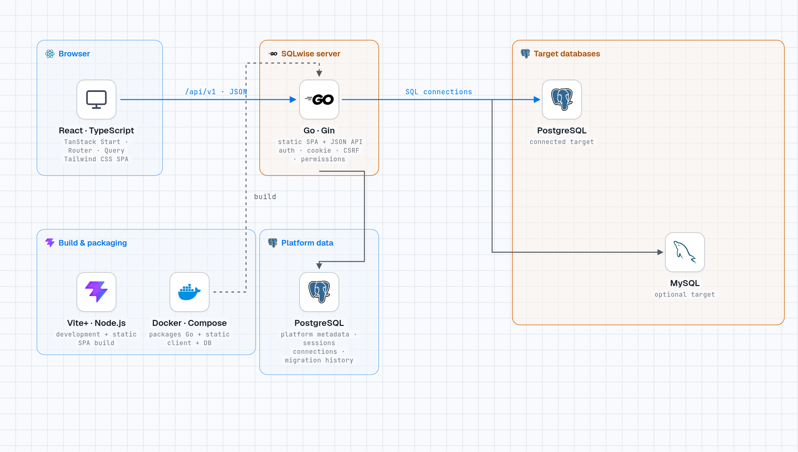

# SQLwise architecture and features

SQLwise is a database management web app for the IF3110 Web Application Development course. It combines connection administration, a schema and data explorer, and a workflow for reviewing and running SQL migrations.

## Tech stack

<picture>
  <source media="(prefers-color-scheme: dark)" srcset="stack-diagram-dark.png">
  
</picture>

[Open the standalone diagram](stack-diagram.html).

The active frontend in [`web/spa`](../web/spa/) uses React, TypeScript, Tailwind CSS, TanStack Start in static SPA mode, TanStack Router, and TanStack Query. Vite+ builds the client, which Go serves in production. The frontend follows Better T Stack's frontend-only approach: it does not use the JavaScript backend, ORM, or auth service.

The Go and Gin API handles `/api/v1`, including authentication, session rotation, permissions, database connections, and queries. PostgreSQL stores platform data separately from the databases registered as targets. The [worker](jobs.md) applies approved migrations against PostgreSQL targets.

### Retained legacy frontend

The templ/HTMX implementation remains in [`internal/web/views`](../internal/web/views/) and [`web/src`](../web/src/), along with its generated Go, HTML handlers, and regression tests. The production server no longer mounts the legacy HTML routes. `go tool templ generate` and `vp build` still check that frontend. The optional Compose `legacy` profile starts the old asset-development service; it is not a second production UI.

## Milestone 1 foundation

| Area                        | What you can do                                                                             |
| --------------------------- | ------------------------------------------------------------------------------------------- |
| Authentication and sessions | Sign in and manage authenticated sessions.                                                  |
| Access control              | Manage users and groups. Grant each group view or edit access per database.                 |
| Connections                 | Register, test, enable, and disable database connections.                                   |
| Explorer                    | Browse schemas, tables, columns, and data.                                                  |
| Linear migrations           | Write SQL drafts, apply them in order, and inspect database versions and execution results. |

### Milestone 1 bonus features

These statuses describe what shipped in Milestone 1.

| Feature     | Status                  | Details                                                                                                                                           |
| ----------- | ----------------------- | ------------------------------------------------------------------------------------------------------------------------------------------------- |
| MySQL       | Complete                | Connections, browsing, and migrations. Partial or uncertain migration outcomes could be reviewed and reconciled.                                  |
| Schema diff | Complete for PostgreSQL | Compare the live schema with a desired JSON snapshot. Supported changes can become a migration draft; other differences are reported as warnings. |
| Query plans | Complete for PostgreSQL | View `EXPLAIN` plans or run `ANALYZE` for `SELECT` queries on an authorized sandbox connection.                                                   |

## Milestone 2 workflow

- **Responsive SPA.** The same Go JSON API powers sign-in, administration, exploration, and the migration workflow.
- **Rollback, forward, and history.** Define SQL up and down, or mark a migration irreversible with a reason. Roll back the latest active reversible migration and reapply changes in order. Committed history is separate from [execution attempts](jobs.md#workflow-and-worker-behavior); **Hide rollbacks** filters out canceled pairs without deleting them.
- **Review and approval.** The leader of each group with view or edit access to the database must approve the request. This also applies to rollback and forward requests.
- **Asynchronous execution.** The API queues approved requests; the worker executes them. The Jobs page shows progress, and checkpointed batches can be resumed or compensated after review. See [Migration jobs and recovery](jobs.md).
- **Logging, tracing, and audit.** Structured JSON logs and OpenTelemetry traces connect API requests, jobs, and SQL on PostgreSQL and MySQL. State-changing API calls emit an `audit` event with the actor, targets, and outcome. See the [event reference and samples](observability/logging-and-tracing.md) or [local Grafana setup](../deploy/observability/README.md).

Reviewed execution in Milestone 2 is PostgreSQL-only. MySQL connections, browsing, and existing migration records remain available. There is no synchronous MySQL fallback for reviewed execution.

### Milestone 2 bonus features

| Feature           | Status                                                                                                         | Guide                                                                                                |
| ----------------- | -------------------------------------------------------------------------------------------------------------- | ---------------------------------------------------------------------------------------------------- |
| Observability     | Local stack and dashboard included. Panels cover API traffic, queue and migration metrics, and database pools. | [Local observability and verification](../deploy/observability/README.md)                            |
| k6 stress testing | The staged runner and measured results are included.                                                           | [Runner, thresholds, and results](k6/README.md)                                                      |
| CodeQL SAST       | GitHub Actions scans Go and JavaScript/TypeScript.                                                             | [Workflow](../.github/workflows/codeql.yml) · [Finding register and scan evidence](codeql/README.md) |

The separate early-submission bonus depends on the submission time and is not claimed here.

## Team

| Student ID | Member                         | Main contributions                                                                                   |
| ---------- | ------------------------------ | ---------------------------------------------------------------------------------------------------- |
| 13524034   | Jason Edward Salim             | Database connections and explorer, durable queue and worker, batch recovery, Jobs UI and benchmark   |
| 13524037   | Nicholas Wise Saragih Sumbayak | Authentication, sessions, access control, administration, frontend foundation, CI                    |
| 13524106   | Michael James Liman            | Migration editor, approval workflow, rollback and forward, committed history, schema diff and CodeQL |
